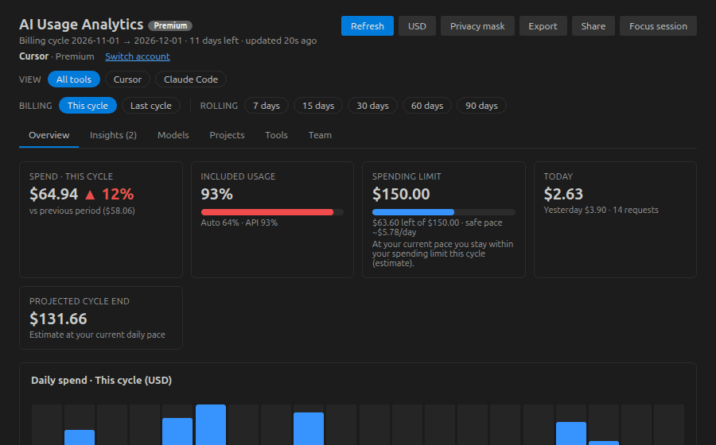
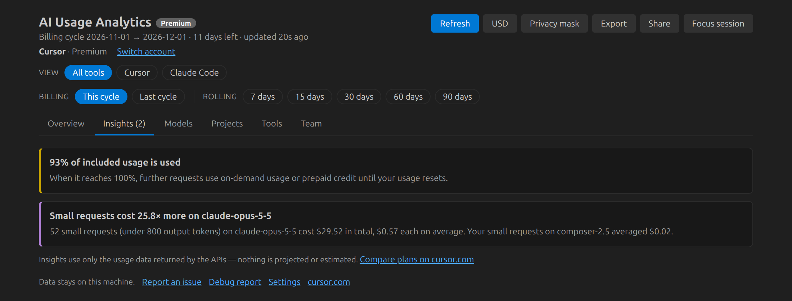
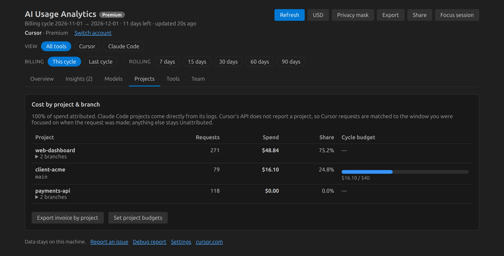
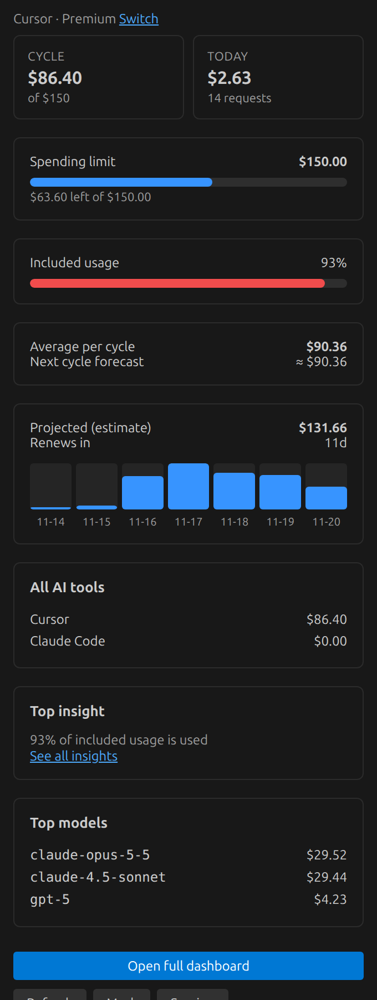

# AI Spend Monitor — Cursor & Claude Code Usage

[](CHANGELOG.md)
[](https://open-vsx.org/extension/subashpatra/cursor-cycle-monitor)
[](https://github.com/sp23011986/cursor-cycle-monitor/actions/workflows/ci.yml)
[](SECURITY.md)
[](LICENSE)

**Know what your AI coding really costs, straight from the official APIs, without leaving the editor.**

**Real data only:** every amount comes from Cursor's, GitHub's or the team Admin API, or from Claude Code's own logs. The only estimate, the projected cycle-end spend, is labelled as one.

Live **Cursor** spend and included usage in your status bar, plus **Claude Code** and **GitHub Copilot**, usage insights, **cost per project**, budgets, focus sessions and a team dashboard. Setup is zero-config and the extension has zero dependencies. Nothing leaves your machine.

```text
✦ Cursor $18.56/$200 · Today $0.45 ▁▃▅▇▆▂▄ · $181.44 left · 11d · claude-4.5-sonnet
```



---

## Why developers install it

- **Know before you're billed.** An included-usage meter, a projected run-out date and alerts, so on-demand charges never surprise you.
- **Spend less, based on facts.** The Insights tab compares what small requests actually cost on each model you use, and shows your real prompt-cache hit rate and spike days. No guessed savings.
- **Bill clients accurately.** Cost per project and git branch, with a one-click invoice export.
- **See all your AI tools in one place.** Cursor, Claude Code (from local logs) and Copilot (experimental).
- **Zero setup, zero dependencies.** It uses the cursor.com sign-in you already have, silently, with no login prompt. No Python, no extra tools.
- **Private by design.** Local-only, no telemetry, encrypted secrets, and a one-click privacy mask for screen sharing.

## Features

| | |
| :-- | :-- |
| **Live status bar** | Cycle spend, limit, today, sparkline, days left and top model. Customizable with a template, including all-tool totals. |
| **Who's signed in & multiple accounts** | The header shows the account behind each tool (name, email, plan) from Cursor's `/api/auth/me` and Claude Code's `.claude.json`. Every browser profile signed into cursor.com is its own account with separate history, and Claude Code accounts come from separate config folders. **Switch account** in one click; **enterprise/team accounts are the default**. A **View** selector (All tools · Cursor · Claude Code) applies to every tab. Emails follow the privacy mask. |
| **Spending limit, clearly** | Answers "is there a $ cap?" first, exactly as Cursor reports it: a cap set by you or your team admin with the amount left, a shared team pool, **No $ cap set**, or **No $ cap set · included usage only** (on-demand off, so you can't be charged extra). |
| **Included-usage meter** | Auto and API pools, with alerts at 80% / 100%. |
| **Yellow / red at a glance** | One rule everywhere (status bar, cards, sidebar): **yellow at 70%** and **red at 90%** of whatever actually limits you, whether a Cursor cap, a team pool, included usage when on-demand is off, or your personal budget. Configurable with `warnAtPercent` / `criticalAtPercent`. |
| **Days until your limit** | "At your current pace you'll reach your spending limit in ~4 days, around 2026-11-25 (estimate)", with an alert when it's 3 days away. Shown only against a real ceiling. |
| **Recommend to your team** | One command copies a ready-to-post message, the install command or the store link. Share cards and digests carry a small install link (switch it off with `includeInstallLink`). |
| **Weekly digest to Slack / Discord / Teams** | Opt-in. Every Monday it posts last week's spend, change, top model, limit status and forecast (plus a team summary for admins). No names or emails, and amounts follow the privacy mask. |
| **Quarter review & forecast** | The last 3 billing cycles with real spend, requests and the change between them; the actual average per cycle; and a next-cycle forecast (labelled an estimate) compared with your limit. Cycles before your first use or outside fetched history are excluded. |
| **Analytics dashboard** | Overview, Insights, Models, Projects, Tools and Team tabs. Ranges: **Billing** (this cycle, last cycle) and **Rolling** (7, 15, 30, 60, 90 days), with the change vs the previous period whenever that period is fully covered by history. |
| **Patterns** | Daily spend, an hour×weekday heatmap, and billing split (included / on-demand / free / background agents). Tokens and cache-hit rate. |
| **Usage insights** | Factual comparisons from your own data: actual cost of small requests per model, prompt-cache hit rate, included usage used, Max-mode and agent share, spike days. |
| **Cost per project & branch** | Automatic attribution from the focused window. Claude Code logs carry the project directly. |
| **Budgets** | Monthly budget, per-project budgets, a daily alert and a safe-pace warning. |
| **Focus sessions** | Start a session with its own budget. The status bar tracks it live and shows a summary when you stop. |
| **Alerts anywhere** | Editor notifications, plus Slack, Discord, Teams or any https webhook. |
| **Team dashboard** | For Cursor team admins via the official Admin API: spend per member, activity, top models and outliers, with CSV export. |
| **Multi-tool** | Claude Code requests and tokens from its local logs (cost only when Claude Code records it), and GitHub Copilot premium requests from GitHub's billing API (experimental). |
| **Weekly recap & share card** | A Monday summary, and a 1200×630 PNG for **this week so far**, **last week**, **this month so far**, **last month** or the **last 12 weeks**, with amounts optionally hidden. |
| **Exports** | Markdown / Slack / email reports, CSV / JSON of every request, invoice by project. |
| **Any currency** | Every ISO currency at live ECB reference rates (Frankfurter), with the rate date shown, or your own fixed rate. No built-in rates: without a live rate, amounts stay in USD. |
| **Localized** | English, German, Spanish, Portuguese (Brazil), Japanese, Chinese (Simplified) and Hindi. |
| **Lightweight** | Incremental sync, adaptive polling, one polling window, and it pauses when unfocused. |

### Screenshots

| Usage insights | Cost per project & branch | Sidebar |
| :-: | :-: | :-: |
|  |  |  |

*Screenshots use synthetic demo data.*

## Install

[-a855f7?style=for-the-badge)](https://open-vsx.org/extension/subashpatra/cursor-cycle-monitor)

In Cursor: **Extensions** (`Ctrl/Cmd + Shift + X`), search **"AI Spend Monitor"**, and click **Install**. Or from a terminal:

```bash
cursor --install-extension subashpatra.cursor-cycle-monitor
```

Open the dashboard any time with **Ctrl+Alt+U** (macOS: **⌥⌘U**). It also works in VS Code; without a Cursor account it shows your Claude Code and Copilot usage.

## Setup & Authentication

**There is nothing to set up and no login prompt.** The extension uses a sign-in you already have:

1. **Your cursor.com browser sign-in.** This is found automatically and silently in Firefox (incl. LibreWolf and Zen) or Chrome, Edge, Brave, Chromium, Vivaldi or Arc, including Ubuntu snap and Flatpak installs. It's read locally with Node.js built-ins and your OS keyring (GNOME Keyring/KWallet over D-Bus, or Windows DPAPI) and never uploaded. On macOS, reading a browser key always shows a Keychain dialog, so there it only runs when you click **Connect Account**.
2. **Cursor's in-app login.** Cursor currently allows its login API (`vscode.cursor`) only for extensions on its own allowlist. The extension tries it safely and uses it automatically if Cursor ever allows it.
3. **Manual:** **AI Spend Monitor: Connect Account** → paste the `WorkosCursorSessionToken` cookie, or use DevTools **Network → Copy as cURL** on cursor.com.

**Session renewal is automatic.** Once a day, and whenever the session is within 3 days of expiry, the extension silently re-reads your browser's newer session (your browser renews it whenever you visit cursor.com). The tooltip shows where the session comes from and when it's valid until. If it ever expires, open cursor.com in your browser once; nothing needs reconnecting.

### Optional connections

- **Claude Code:** on by default if `~/.claude/projects` exists (setting `providers.claudeCode`).
- **GitHub Copilot:** run **AI Spend Monitor: Connect GitHub Copilot Usage**.
- **Team dashboard:** run **AI Spend Monitor: Add Team Admin API Key** (team admins only).
- **Slack / Discord / Teams alerts:** run **AI Spend Monitor: Configure Alert Webhook**.

## Commands

All commands are under **AI Spend Monitor:** in the Command Palette.

| Command | What it does |
| :-- | :-- |
| Open Analytics Dashboard / Show Usage Insights / Open Team Dashboard | The full dashboard, opened on a specific tab |
| Open Quick Menu | Everything in one place (also: click the status bar) |
| Start / End Focus Session | Track a work session's spend against its own budget |
| Export Usage | Markdown / Slack / email, CSV, JSON, invoice by project |
| Share Usage Card | A PNG of this week or month so far, last week or month, or the last 12 weeks, with amounts optionally hidden |
| Set Project Budget | Monthly budget for the current project |
| Configure Alert Webhook / Send Test Alert | Slack, Discord, Teams or a generic https endpoint |
| Add / Remove Team Admin API Key | Team dashboard |
| Connect GitHub Copilot Usage | Experimental Copilot premium-request tracking |
| Connect / Disconnect Account | Manage the Cursor session |
| Toggle Privacy Mask · Switch Display Currency · Configure Settings | Display options |
| Show Logs · Report an Issue · Delete Local Usage Data | Support and privacy |

## Settings

| Setting | Default | Description |
| :-- | :-: | :-- |
| `statusBarTemplate` | `""` | e.g. `$(sparkle) {used}/{limit} · {today} · {daysLeft}d`. Tokens: `{used} {limit} {left} {pct} {today} {yesterday} {projected} {daysLeft} {topModel} {spark} {included} {prompts} {allTools} {allToday}` |
| `compactMode` · `showTopModel` · `showSparkline` · `privacyMask` | | Status bar display |
| `defaultLimitDollars` | `0` | Personal monthly budget in USD when there's no admin cap |
| `dailyAlertDollars` | `0` | Daily spend alert in USD |
| `projectBudgets` | `{}` | e.g. `{ "client-a": 50 }`: alerts at 80% / 100% |
| `enableSpendAlerts` · `weeklyRecap` | `true` | Alerts and the Monday recap |
| `currency` · `currencyRate` · `liveFxApiKey` | `USD` | Any ISO currency at live rates, or your own fixed rate |
| `timezoneOffsetHours` | `auto` | Timezone for "today" |
| `providers.claudeCode` · `providers.copilot` | `true` · `false` | Other AI tools |
| `claudeConfigDirs` | `[]` | Extra Claude Code config folders (one per account, e.g. a work `CLAUDE_CONFIG_DIR`) |
| `attribution.enabled` · `attribution.hashProjectNames` | `true` · `false` | Cost-per-project tracking |
| `historyDays` | `130` | History kept for the rolling views, last cycle, the quarter review and the share cards (max 130) |
| `warnAtPercent` · `criticalAtPercent` | `70` · `90` | When indicators turn yellow / red |
| `refreshIntervalSeconds` · `pauseWhenUnfocused` · `autoFetchBrowserCookie` | `60` · `true` · `true` | Data and connection |

All settings are prefixed with `cursorCycleMonitor.`.

## Privacy & security

- **Zero dependencies**: only Node.js built-ins and standard OS tools.
- Each credential (Cursor session, Admin API key, webhook URL) is sent **only** to the service it belongs to and is stored encrypted.
- **No telemetry.** Claude Code logs are read locally for token counts only. Project tracking stores folder names (optionally hashed).
- Works in Remote-SSH, WSL and Dev Containers, where it runs on your local side.

Details: [SECURITY.md](SECURITY.md).

## Troubleshooting & support

See [SUPPORT.md](SUPPORT.md). Still stuck? Run **AI Spend Monitor: Report an Issue**. It opens [GitHub issues](https://github.com/sp23011986/cursor-cycle-monitor/issues) and copies a **debug report** to your clipboard: recent logs, API calls (endpoint, status and timing only), state and settings. **Tokens, cookies, emails, account IDs, webhook URLs, API keys and amounts are removed automatically.** You can also run **AI Spend Monitor: Export Debug Report** to review it in an editor or save it as a file first.

## More

[Changelog](CHANGELOG.md) · [Support](SUPPORT.md) · [Security & privacy](SECURITY.md) · [Report an issue](https://github.com/sp23011986/cursor-cycle-monitor/issues) · [License](LICENSE)

> Not affiliated with Anysphere / Cursor, Anthropic or GitHub. Product names are trademarks of their owners. The projected cycle-end spend is a straight-line estimate at your current daily pace; all other figures are reported by the respective APIs.

## License

**Official builds are free to use**, for any purpose including commercial use, on any number of machines, forever. Install from Open VSX or the VS Code Marketplace; no key is needed.

The source code is **source-available, not open source**: you can read it, but building or running it from source, modifying it or redistributing it requires a license key from the author. A build made from this repository starts in a locked mode and asks for a key. See [LICENSE](LICENSE). Versions before 3.0.0 were MIT-licensed and remain so.

© 2026 Subash Patra
